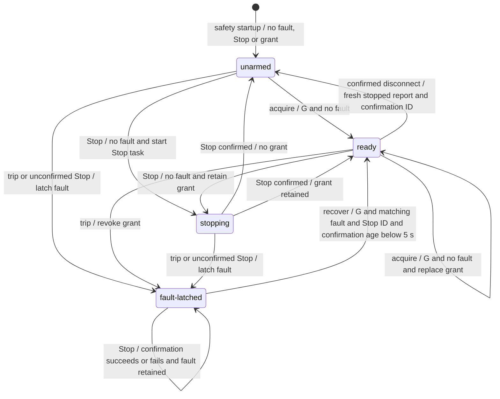

# Safety authorization states and recovery

Checked against the code on November 9, 2026. This describes the dedicated
safety process, not the direct Web Bluetooth controller. The code is the
authority. These states describe software authorization, not proof that a
physical belt is safe.

The safety process owns Bluetooth, faults, Stop and motion grants in
[`SafetyCore`](../bridge/safety_core.py). It inherits the serialized writer and
Stop kernel from [`control_core.Controller`](../bridge/control_core.py).
The application process uses [`controller.Controller`](../bridge/controller.py)
to manage clients and recording. It reaches safety through
[`SafetyClient`](../bridge/safety_client.py) and
[`SafetyServer`](../bridge/safety_ipc.py). Request schemas are in
[`messages.py`](../bridge/messages.py) and
[`safety_messages.py`](../bridge/safety_messages.py).

## Reported states

`SafetyCore.snapshot()` computes `authorization_state` on every call. It is not
a stored state machine. The first matching row wins:

| State | Exact condition | Meaning |
| --- | --- | --- |
| `fault-latched` | `fault_id` is truthy | Explicit fault recovery is required. This takes precedence even while Stop is pending. |
| `stopping` | No fault, and `stop_task` exists and is not done | The Stop kernel is running. A grant may still exist. |
| `ready` | No fault or pending Stop, and `grant_id` is truthy | A motion grant exists. Other motion gates still apply. |
| `unarmed` | No fault, pending Stop or grant | No motion grant exists. This includes startup and a confirmed disconnect without a fault. |

`link_state`, `connected`, `bridge_healthy`, `stale`, `recording_ready` and
`recording_review` are separate snapshot fields. A `ready` snapshot does not
assert that all of them permit motion. The application's `snapshot_for()`
computes `blocked` from safety availability, the reported state and
`storage_fault`; it does not include every motion guard, including review.
Likewise, inherited event data such as `state='ready'` is not the authorization
state. Use the snapshot and live guards, not that event label.

Here `G` is the common grant guard in the next section. Claiming recovery,
resolving a record and publishing readiness do not themselves change the
reported state. A Stop during a fault remains `fault-latched`, not `stopping`.
Successful `release` and `stop_disconnect` pass through Stop before disconnect.
Ordinary Start/Pause/Set speed and renewals keep the same authorization label
unless they trip a fault.

## Gates and fault behavior

Safety treats `start`, `pause` and `set_speed` as motion. Pause has the same
authority and recording gates as Start. Stop has its own path.

Application `dispatch()` allows a non-owner client to request Stop with the
current generation. Safety's application Stop path checks full attachment/link/
fault authority, but does not require a grant, health, lease, telemetry freshness
or recording readiness/review. Storage failure does not disable Stop. The direct
safety helper can request Stop without application authority. Release checks
that the supplied grant ID matches safety's current grant ID. If the motion owner's client disconnects,
application `client_lost()` sends `owner_lost`; safety checks the grant, trips
`Motion controller connection lost` and awaits Stop. Claimant loss alone clears
the claimant without tripping safety.

The common grant guard **G**, in `SafetyCore.handle_application()` for both
`acquire` and `recover`, requires all of these:

- No `motion_pending`, no connection in progress and no `writer_uncertain`.
- A connected Bluetooth link and `health.is_healthy()`.
- A last report with `last.stopped`, and `last_valid` less than 5 seconds old.
- `recording_ready` true and no unfinished `stop_task`.

A failed G only refuses the request. It does not itself call `trip()`.
`Telemetry.stopped` means state 3 **and** raw speed zero
([`protocol.py`](../bridge/protocol.py)); zero speed alone is insufficient.
Neither grant operation checks `recording_review` or the age of an existing
owner lease. `acquire` additionally requires no fault. `recover` has the extra
fault and confirmation guards described below.

| Gate | Where and bound | Refusal or fault |
| --- | --- | --- |
| Application health | `HealthMonitor.is_healthy()` requires at least one accepted challenge response and an age below 2 seconds. Challenges are issued every 0.25 seconds. Responses must match attachment, pending nonce and increasing challenge sequence, with challenge age below 2 seconds. | No first response means no grant or motion. Expiry trips while connected/connecting in `tick()` or `accept_health()`, and unhealthy motion/renewal trips in `check_authority()`. |
| Motion owner lease | `check_authority()` and `tick()` expire a grant at age **>= 6 seconds** since `renewed`. | Trips a fault. `renew` needs live motion authority except for review. Increasing renewal sequence is required. Renewals less than 1 second after the last accepted renewal return `renewed:false`, consume the command sequence and add no time credit. |
| Telemetry freshness | Snapshot is stale when there is no `last_valid` or its age is **>= 5 seconds**. Grant requires a stopped report younger than 5 seconds. Motion and renew check freshness again. | Motion/renew with missing or expired telemetry trip. `tick()` trips an expired, previously timestamped stream once until another valid report resets `stale_handled`. Invalid telemetry trips immediately. |
| Recording readiness | Safety starts false. `recording_ready` needs full current authority, a strictly newer readiness revision and an exact match to current `fault_id` (including null). | False blocks grants, motion and renew. Publishing false while connected trips `Walk recording unavailable`; while disconnected it only withdraws readiness. A trip resets readiness false. |
| Recording review | Safety starts true. Application `tracking_review` blocks motion in `dispatch()`. Safety checks review at motion dispatch and under the writer lock. | Review alone refuses/cancels motion. Setting true increments `motion_generation`, so clearing it cannot revive queued motion. It does not Stop, revoke a grant, block acquire/recover/renew, or pause any deadline. |
| Storage | Application `storage_fault` is latched by `recording_failed()` after worker failure, including queue overflow. `dispatch()` refuses motion and record resolution; `publish_readiness()` withholds true. | Application schedules `withdraw_readiness()`. Its accepted false publication trips safety if connected. There is no in-place storage-fault clear operation. |
| Attachment and authority | `check_authority()` matches `safety_id`, `link_epoch`, `fault_generation` and attached `bridge_id`. Motion/renew also need the current grant, no fault, a connected link, readiness, no pending Stop and an increasing `command_seq`. | Mismatches refuse. The health/lease/telemetry checks in this path can trip before the final refusal. Review uses only safety/attachment identity and its own increasing revision, so it survives link/fault changes. |
| Client and request identity | Application `dispatch()` requires the current generation except for observe/discover, limits helpers to Stop operations, and requires the motion owner for motion/owner renewal. Motion IDs cannot repeat; the set is limited to 1024. | Refuses without a safety fault. A change to safety/link/fault/grant authority increments application generation and clears its motion ID set. |
| Safety request budget and writer | Safety refuses duplicate/out-of-order motion and a busy motion writer. After 1024 accepted motion requests in a grant, the next motion request trips `Controller request limit`. `grant()` resets this count. | Busy/duplicate requests only refuse. Request-count exhaustion trips. IPC validation/backlog limits also refuse; a lost attachment can then trip separately. |
| Queued writes | `SafetyCore.write()` checks connection generation, motion generation and `blocked` under its lock. The motion `before()` callback rechecks authority, review, readiness, fault, health, grant, 6-second lease and 5-second telemetry bounds. | `CommandCancelled` refuses/cancels without directly tripping. Deadline ticks still apply. Other motion-write exceptions trip; a failed/cancelled non-Stop write can set `writer_uncertain`. |
| Stop and connection | Pending Stop blocks grants, motion and renewal. `writer_uncertain` blocks grants and prevents Stop confirmation. | Unconfirmed Stop latches a fault and clears grant/owner/readiness. Connection failure, link loss and heartbeat-write failure also trip. |

See [`safety_health.py`](../bridge/safety_health.py) for timing constants and
`HealthMonitor`, and `SafetyCore.check_authority()`, `handle_application()`,
`write()`, `tick()`, `packet()` and `heartbeat()` for the safety checks. Deadlines
use elapsed boot time, including host suspension. `SafetyServer.run_deadlines()`
runs every 0.05 seconds and closes an expired application's socket. Checks also
run as frames arrive; these periods are not guarantees of physical stop latency.

`recording_review` and `recording_ready` are independent. In application
`record()`, an interrupt or safety-evidence item sets review synchronously before
recording work runs. Telemetry gaps also queue interruption. `RecordingWorker`
tracks queued interruptions and an interrupted row. `recorded()` recomputes
review after each worker update. Review is published immediately with `notify()`;
the safety server applies it inline in socket order, outside the normal backlog.
A rejected notification makes the safety client unavailable. See
[`recorder.py`](../bridge/recorder.py), `RecordingWorker.requires_review()` and
`run()`, and application `set_tracking_review()` / `publish_review()`.

## From a fault to a new grant

This is a usable client sequence, not a single atomic operation. Guards are
checked again at each boundary. Expired health or a recording failure must be
addressed before recovery can succeed.

1. **Safety latches the fault.** `SafetyCore.trip()` creates a fault ID and
   increments `fault_generation` only for a new fault. It clears grant, owner
   and readiness, sets motion blocked and increments `motion_generation` even
   for an existing fault. A new fault starts Stop if connected, not closing and
   not already stopping. Repeated trips retain the original fault/reason and
   do not start another Stop. An unconfirmed `stop()` can also create a fault.
   Fresh stopped telemetry and a successful Stop do not clear that fault.
2. **The application observes and preserves recording evidence.**
   `Controller.received()` queues safety evidence for a newly seen fault and
   interrupts tracking on fault/loss or gaps. `collect_safety_evidence()` reads
   the safety ring on initialization/reconnect when a fault exists. Evidence is
   provenance, not another counted stream of workout samples. If a walk exists,
   `Recorder.safety_evidence()` persists it as interrupted with partial coverage.
3. **A browser or tray claims record/recovery control.** Client
   `connect {recover:true}` reaches application `dispatch()`. It opens safety
   IPC if unavailable, refuses a different current claimant, then sets claimant
   and `claimed_at`. This does not connect Bluetooth, grant motion or require a
   fault. A normal device `connect` that ends with a fault also sets claimant.
   The claimant's `renew` updates `claimed_at` without renewing a motion grant.
   `tick()` clears a claimant at age **>= 6 seconds**; client loss clears it too.
   The claimant alone may acknowledge recovery. Owner or claimant may resolve a
   record. These dispatch paths check claimant identity, not lease age directly;
   expiration is enforced when the application tick runs.
4. **Reconnect Bluetooth explicitly if needed.** Claiming and automatic safety
   IPC reconnect do not do this. Discover and client `connect {device_id}` reach
   `SafetyCore.connect_device()`, which requires a discovered device and no
   current connection/connection attempt. It advances link authority, clears
   telemetry, connects, then performs initial Stop verification. A surviving
   fault stays latched. An unconfirmed initial Stop trips a fault.
5. **Resolve any interrupted record in the application.** Client
   `resolve_session {session_id,choice}` requires owner or claimant, a recorder
   and no storage fault. `RecordingWorker.submit()` waits for `Recorder.resolve()`
   to persist a matching interrupted record. `continue` keeps the session with
   partial coverage, sets it paused and waits for continuity; stopped reports
   do not immediately finish it. `new` archives the interrupted row, clears the
   current walk and establishes a new partial boundary. There is no record
   choice to make if no interrupted record exists.
6. **The application publishes readiness for the current fault.**
   `publish_readiness()` drains recording work, republishes review and withholds
   true if storage has failed or the session remains interrupted. Otherwise it
   sends `recording_ready {ready:true,revision,fault_id}`. Safety requires full
   current authority, an increasing revision and the current fault ID. Resolution
   calls this method; acknowledgment calls it again. Without a configured
   recorder, the method can publish ready too; safety trusts this application
   assertion rather than inspecting a record itself.
7. **Confirm Stop and acknowledge.** The browser's
   `BridgeTransport.acknowledgeRecovery()` in [`transports.js`](../transports.js),
   Omarchy [`Service.qml`](../integration/omarchy/gabe.pitpat/Service.qml)
   `acknowledgeRecovery()` and macOS
   [`Service.swift`](../integration/macos/PitPatMenuBar/Sources/PitPatMenuBar/Service.swift)
   `acknowledgeRecovery()` request Stop before sending
   `acknowledge_recovery {fault_id,stop_confirmation_id}`. They check that the
   fault still matches. Application `dispatch()` requires the claimant,
   republishes readiness and forwards `recover` with the client's owner ID/kind.
   It does not itself issue Stop.
8. **Safety checks recovery and grants control.** `handle_application('recover')`
   requires G, an existing matching fault ID, a matching Stop confirmation ID,
   non-null `confirmed_at` and confirmation age **< 5 seconds**. It clears the
   fault ID/object and calls `grant()`. The grant gets a new ID and owner, target
   speed 1000, a new lease timestamp, reset renewal/command sequences and motion
   count, and a new motion generation. The application clears claimant after
   success. The result is `ready`; no Start is sent. Review and all other live
   motion gates still apply to the next motion request.

Stop confirmation comes from `SafetyCore.stop()` and inherited
`Controller.stop()` / `perform_stop()`. Stop invalidates queued motion and joins
an existing Stop task or starts one. The kernel has a **5-second total deadline**
for the serialized Stop write and a fresh stopped report. The report must arrive
after the writer marks `stop_min_sequence` and leave the same connected
connection generation stopped. Safety also requires no `writer_uncertain`.
It then creates a confirmation ID/time for the `(link_epoch, stop_min_sequence)`
proof. Non-stopped telemetry clears ID/time; link loss clears the ID. Ordinary
Stop retains an existing grant on success; failure revokes it. Confirmed release
or stop-disconnect disconnects only with a confirmation ID and stopped telemetry
less than 5 seconds old.

## Taking control without a fault

Client `take_control` forwards `acquire` with the requesting browser/tray identity.
It requires G and **no fault**, but neither a recovery claimant nor a fresh Stop
confirmation ID/time. Fresh stopped telemetry is enough. It can create a grant
when there is none or replace an existing owner's grant while stopped. It does
not require the previous owner's permission or a live previous lease.

If an interrupted startup record withholds readiness on a fault-free connection,
there may be no owner yet. A client can claim with `connect {recover:true}`,
resolve the record, then use `take_control`. `acknowledge_recovery` cannot solve
this case because safety `recover` requires an actual fault. Acquire does not
clear the application claimant; it remains until expiry, client loss or successful
fault acknowledgment. A normal fault-free device connection publishes readiness
and calls `acquire` automatically after initial Stop verification.

## Attachment and reconnect resets

- **Safety application attach:** `attach_application()` attaches health, starts
  its 2-second response window with no accepted answer, clears pending challenges,
  resets readiness false/revision -1 and review true/revision -1, and increments
  motion generation. It does not clear faults, telemetry, confirmation or grant.
- **Matching application detach:** `detach_application()` detaches health,
  clears its pending responses, resets the same recording fields and increments
  motion generation. If connected/connecting, it trips, revoking grant/owner and
  retaining or creating a fault. Detaching another bridge ID does nothing.
  Health challenge/accepted sequence counters are not reset by attach/detach.
- **Application loses safety IPC:** `SafetyClient.unavailable()` closes the
  writer, clears pending notifications and fails waiting requests. It retains
  its cached snapshot. Application `received('lost')` clears local owner/claimant,
  marks disconnected and interrupts recording. Cached telemetry is not new proof.
- **Application reconnects to safety:** `reconnect_safety()` restores only IPC,
  observation and health, collects fault evidence and republishes review/readiness.
  It does not discover/connect Bluetooth, resolve a record, acquire or recover.
  `tick()` schedules retries with a 1-second delay after each attempt.
  `SafetyClient` resets its motion command sequence when it sees a changed grant;
  application `received()` increments generation and clears motion IDs when the
  safety/link/fault/grant tuple changes. Existing storage faults and recorder
  contents remain. Recording revision counters on the application keep increasing.
- **Safety process restart:** a new `SafetyCore` has a new safety ID, no fault,
  grant, owner, link, telemetry or confirmation, readiness false and review true.
  This is a new authority incarnation, not recovery of the old physical state.
  Persisted current recording is loaded as interrupted by `Recorder` at
  application startup. Safety does not reconnect Bluetooth automatically.
- **Explicit Bluetooth reconnect:** `connect_device()` advances link/generation,
  clears last telemetry, resets `writer_uncertain` after backend connection and
  performs initial Stop. It does not clear a latched fault or reset recording
  revisions/review. It is separate from reconnecting the IPC socket.

## Differences and review concerns

The issue's linear summary is a useful client workflow, with these qualifications:

- Claiming is an application permission, usable even without a fault. Its 6-second
  expiry is tick-driven. Safety has no claimant field or claimant-lease check.
- Record resolution is conditional. No interrupted record means no choice is
  needed. Readiness is the application's assertion, not safety's record check.
- Stop can confirm before record resolution, including through the automatic Stop
  on a new fault. Recovery checks age and matching IDs, not ordering relative to
  resolution. The clients normally request another Stop when acknowledging.
- Review blocks motion, not grants or recovery. `ready` can coexist with review
  true and refused motion; review does not itself Stop an already moving belt.
- **Confirmation binding deserves review:** `trip()` does not clear an existing
  confirmation or bind it to the new fault. Before its scheduled Stop starts,
  recovery's code guards can accept a still-fresh pre-fault confirmation if all
  other guards, including newly published readiness, hold. Clients normally
  request Stop, but safety does not explicitly require a post-fault confirmation.
  A synthetic check using the existing `SafetyCoreTests` fake backend reproduced
  acceptance of the old ID before the scheduled Stop ran. No hardware was used.
- **Lease enforcement deserves review:** claimant-sensitive dispatch checks do
  not check `claimed_at`. If an application tick is delayed, a claimant older
  than 6 seconds can still act or renew before the tick clears it.

These are descriptions of the current guards, not changes to them. No physical
connection or motion is needed to review this document.
